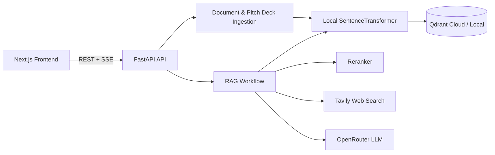
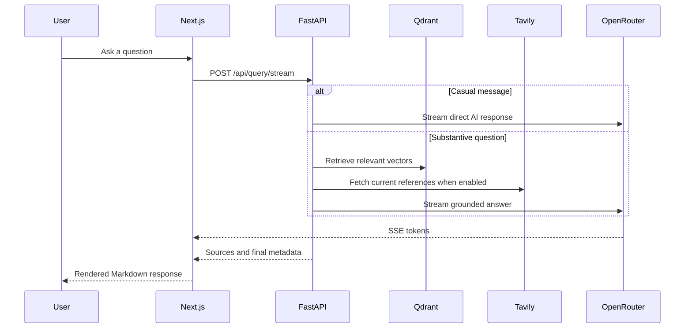

# DealFlow AI

> AI-powered startup intelligence for founders, investors, and ecosystem researchers.

DealFlow AI combines semantic search, retrieval-augmented generation, investor matching,
funding analytics, multilingual assistance, and web-grounded research in one full-stack
application. It is designed as a practical portfolio project that can run locally or be
deployed with free-tier services.

## Highlights

- **AI chat assistant** powered by OpenRouter with streamed Markdown responses.
- **Guardrailed answers** focused on startups, entrepreneurship, funding, investors,
  business, and government schemes.
- **Qdrant vector search** for investors, startups, funding deals, policies, and news.
- **Local sentence embeddings** using `all-MiniLM-L6-v2`, avoiding a separate paid
  embedding provider.
- **Investor discovery and matching** using semantic retrieval and reranking.
- **Funding trend analysis** for sectors, stages, locations, and time periods.
- **Multilingual support** with language detection and IndicTrans2 integration.
- **Optional Tavily research** for current web references on substantive questions.
- **Pitch-deck processing** with document parsing and structured AI extraction.

## Architecture



### Query flow



## Technology stack

| Layer | Technology |
| --- | --- |
| Frontend | Next.js 14, React, TypeScript, Tailwind CSS |
| Backend | Python, FastAPI, LangGraph |
| LLM | OpenRouter OpenAI-compatible API |
| Embeddings | SentenceTransformers (`all-MiniLM-L6-v2`) |
| Vector database | Qdrant |
| Web research | Tavily |
| Translation | IndicTrans2 |
| Charts | Recharts |

## Quick start

### Prerequisites

- Python 3.9 or newer
- Node.js 18 or newer
- A Qdrant Cloud cluster or local Qdrant instance
- An OpenRouter API key
- Optional: Tavily, LlamaCloud, Hugging Face, and Jina API keys

### Backend

```powershell
cd backend
python -m venv ..\venv
..\venv\Scripts\Activate.ps1
pip install -r requirements.txt
copy .env.example .env
python -m app.main
```

Set at least these values in `backend/.env`:

```env
OPENROUTER_API_KEY=your-openrouter-key
OPENROUTER_MODEL=openrouter/free
QDRANT_URL=https://your-cluster-url
QDRANT_API_KEY=your-qdrant-key
LOCAL_EMBEDDING_MODEL=sentence-transformers/all-MiniLM-L6-v2
```

### Frontend

```powershell
cd frontend
npm install
copy .env.local.example .env.local
npm run dev
```

Open [http://localhost:3000](http://localhost:3000). The backend runs at
[http://localhost:8000](http://localhost:8000).

## Data ingestion

The repository intentionally excludes raw datasets and secrets. Place your CSV files in
the local `Dataset/` directory, then run:

```powershell
cd backend
python scripts\ingest_investor_csv.py
python scripts\ingest_startup_csv.py
python scripts\ingest_funding_deals.py
```

The ingestion scripts resolve paths relative to the repository and upload in bounded
batches with retries. Re-ingest data whenever the embedding model or vector dimension
changes.

## Development checks

```powershell
cd backend
..\venv\Scripts\python.exe -m compileall -q app scripts

cd ..\frontend
npm run type-check
npm run build
```

## Deployment notes

- Qdrant Cloud Free is suitable for a low-traffic portfolio demo, but has resource and
  rate limits.
- OpenRouter free models can change availability and have shared rate limits.
- Local embeddings increase backend startup time and memory usage but avoid embedding API
  costs.
- Configure production CORS origins and never deploy `.env` files.
- Rotate any API key that has been exposed or committed historically.

## Project layout

```text
DealFlow-AI/
├── backend/       FastAPI services, RAG workflow, ingestion scripts
├── frontend/      Next.js application and chat UI
├── Dataset/       Local-only datasets (ignored by Git)
└── README.md      Project documentation
```

## License

This project is intended for educational and portfolio use. Add an explicit license
before distributing it as a library or commercial product.
